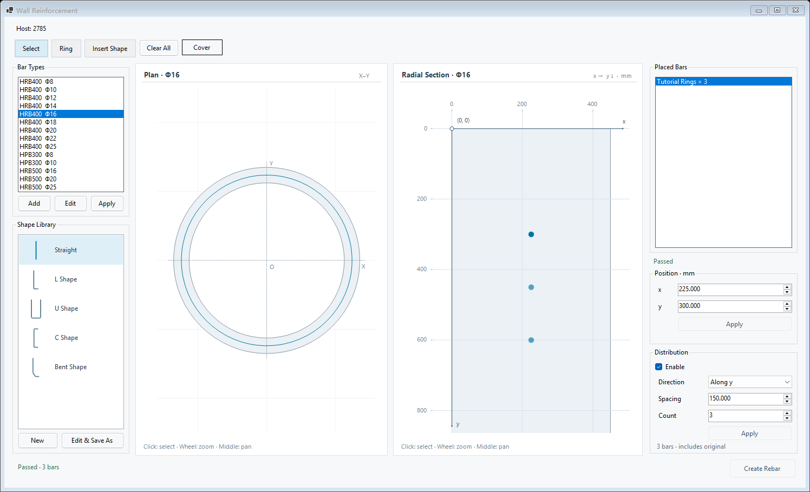
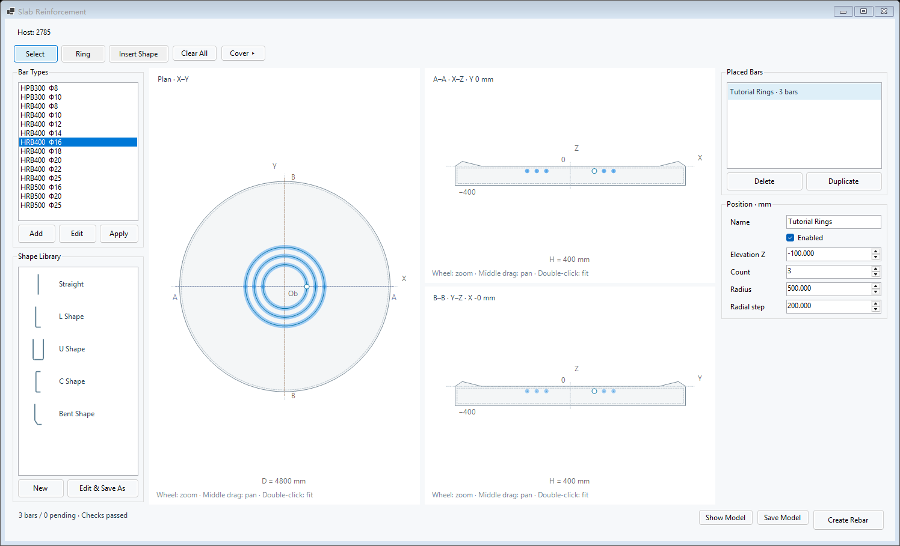

# CaissonRebar 圆形沉井钢筋参数化建模软件

[English](README.md) · [快速上手](docs/QUICKSTART.zh-CN.md) · [安装说明](installer/README.md) · [编译说明](docs/BUILD.md)

本仓库提供用于圆形沉井井壁和底板钢筋参数编辑、图形预览及 Revit 原生钢筋创建的 C# 插件，包含源码、当前用户安装程序和三份脱敏混凝土空壳模型。

英文名称：**CaissonRebar — Parametric Reinforcement Modeling for Circular Caissons**。面向 Revit 2025 的井壁与底板钢筋建模。

## 功能

- 井壁和底板分别使用 **Wall** 与 **Slab** 编辑窗口。
- 编辑钢筋形状、直径及群组布置参数，查看图形预览。
- 读取混凝土宿主几何，通过 Revit API 创建原生钢筋。
- 安装、草稿和日志均使用当前用户目录。
- 示例模型仅包含混凝土宿主，钢筋数量为 0，不含历史配筋参数记录。

## 界面预览

下图由交付 DLL 中的实际 Windows Forms 窗口使用教程输入离线渲染，展示编辑器布局与预览，不是 Revit 实机生成过程截图。

| 井壁编辑器 | 底板编辑器 |
| --- | --- |
|  |  |

## 运行环境

| 用途 | 环境 |
| --- | --- |
| 查看示例模型 | Windows 64 位、Autodesk Revit 2025 |
| 运行插件 | Revit 2025 及其 .NET 8 桌面运行环境 |
| 编译源码 | 支持 `net8.0-windows` 的 .NET SDK、本机 Revit 2025 的 API 程序集 |

主要编辑界面为 Windows Forms；项目同时引用 WPF 支持 Windows 桌面与 Revit 界面配合。包内不分发 Autodesk 主程序或 API DLL。

## 开始使用

仓库：[Dorking643/caisson-rebar-revit](https://github.com/Dorking643/caisson-rebar-revit)。可通过 **Code > Download ZIP** 下载包含源码、安装程序及空壳模型的完整仓库。

1. 下载或克隆仓库；若下载 ZIP，先完整解压。
2. 关闭 Revit，运行 [`installer/Install.bat`](installer/Install.bat)。
3. 启动 Revit 2025，打开 [`models/Wall.rvt`](models/Wall.rvt)、[`models/Slab.rvt`](models/Slab.rvt) 或 [`models/Combined.rvt`](models/Combined.rvt) 的工作副本。
4. 进入 `Caisson Reinforcement > Model Creation`，选择 **Wall** 或 **Slab**，填写参数并检查预览后生成钢筋。

完整步骤见 [快速上手](docs/QUICKSTART.zh-CN.md)。示例不会自动载入原工程的配筋参数。

## 目录

| 目录 | 内容 |
| --- | --- |
| `src` | C# 源码及项目文件 |
| `tests` | 无需实时 Revit 的检查 |
| `scripts` | 编译、测试与文件校验脚本 |
| `installer` | 对应 DLL、安装和卸载程序 |
| `models` | 井壁、底板及组合空壳模型 |
| `docs` | 使用、编译、验证与发布资料 |
| `verification` | 软件检查及模型回读记录 |
| `.github` | 问题反馈、贡献模板和仓库自动化配置 |

## 版本与复核

当前软件标识为 **R36.Share1**，项目版本为 **36.1.0**。本轮整理保留原交付版 DLL 和三个模型文件，补充仓库结构及资料。详见 [版本记录](CHANGELOG.md) 与 [验证说明](docs/VALIDATION.md)。

从仓库根目录执行：

```powershell
dotnet run --project .\tests\Share1Checks\Share1Checks.csproj -c Release
powershell -NoProfile -ExecutionPolicy Bypass -File .\scripts\Test-Installer.ps1
powershell -NoProfile -ExecutionPolicy Bypass -File .\scripts\Verify-Repository.ps1
```

## 反馈、署名及引用

可通过 [GitHub Issues](https://github.com/Dorking643/caisson-rebar-revit/issues) 提交问题，填写版本、重现步骤及脱敏示例，见 [贡献说明](CONTRIBUTING.md)。

**作者顺序：** Guangyao Zhang、Bojin Hao、Wenliang Ma、Lingxin Zeng、Jiaomei Wang、Qiuya Liu、Shangfei Yang。详见 [作者署名](AUTHORS.md)。

**Copyright 2026 The CaissonRebar Authors.** 项目自有源码、编译程序、安装脚本、空壳模型、图片及文档统一采用 [Apache License 2.0](LICENSE)，版权声明见 [NOTICE](NOTICE)，适用范围见 [许可说明](docs/LICENSING.md)。

引用本软件请使用根目录 [CITATION.cff](CITATION.cff)，或参照 [引用说明](docs/CITATION.md)。当前引用版本为 **36.1.0**，公开日期为 **2026-10-29**；引用文件已包含仓库地址，尚未分配软件 DOI。已确定资料见 [发布元数据](PUBLICATION_METADATA.md)，上传步骤见 [GitHub 发布说明](docs/PUBLISHING.zh-CN.md)。
